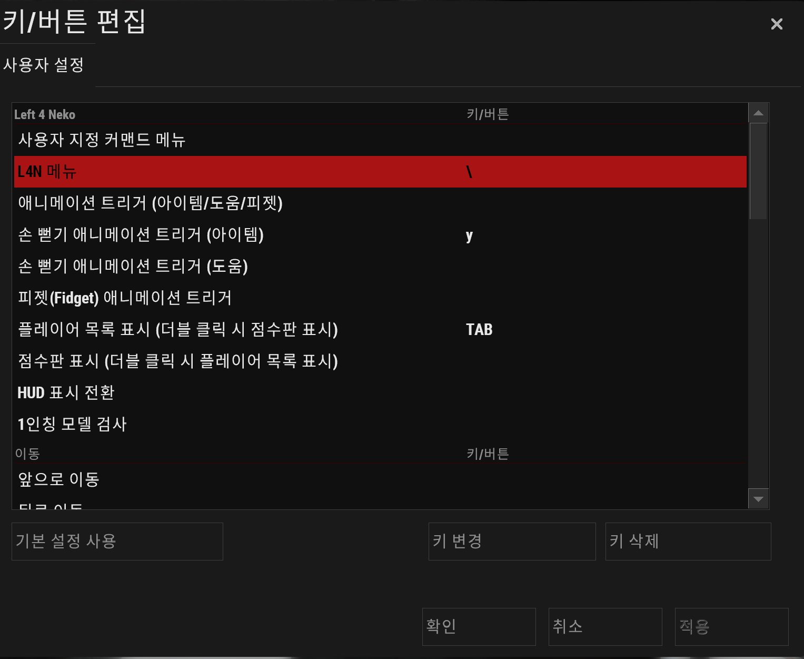
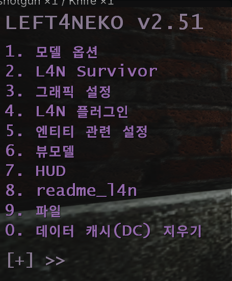
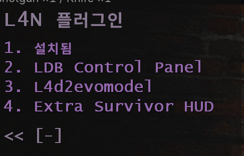
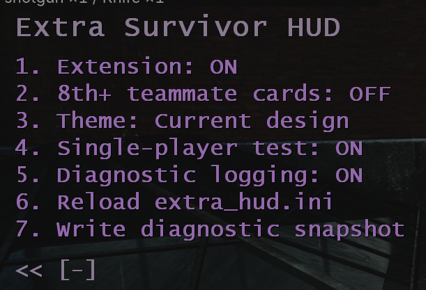
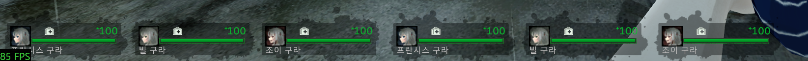
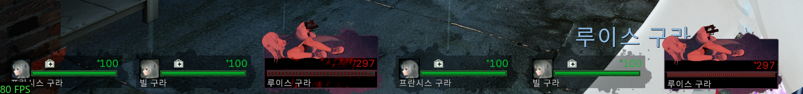
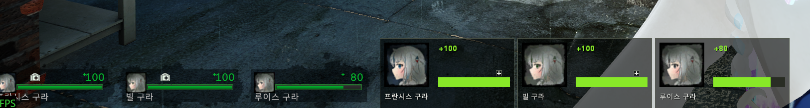
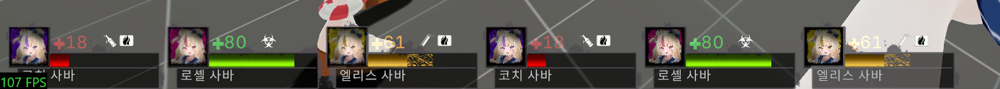
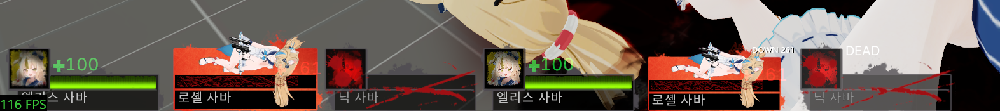

[English guide](README.md)

# L4D2 Outbreak Experience HUD (Built with Neko)

**[배포본 다운로드](https://github.com/Hu-Myo/L4D2-Outbreak-Experience-HUD-Neko/releases)** · [0.1.21 공개 테스트 ZIP](https://github.com/Hu-Myo/L4D2-Outbreak-Experience-HUD-Neko/releases/download/OpenTest/L4D2-Outbreak-Experience-HUD-Neko_0.1.21-public-test.zip)

Neko를 사용하는 레프트 4 데드 2에서 팀원 HUD를 추가로 표시하는 플러그인입니다. **0.1.23을 최종 배포본으로 개발을 마무리합니다.** 플레이하고 테스트해 주셔서 감사합니다.

[한국어 변경 사항](CHANGELOG.ko.md) · [English patch notes](CHANGELOG.md)

0.1.23에서는 사망 후 팀원을 관전해도 해당 팀원이 추가 HUD 표시 대상에서 빠지지 않습니다. 이전 버전의 **게임 내 HUD(In-game HUD)** 테마 다운·매달림 디자인, 아이템 아이콘, 카드 배치 개선도 포함합니다.

Windows용 레프트 4 데드 2와 지원되는 Neko 설치 환경이 필요합니다. DLL 이름은 **NekoExtraHUD**이며, 메뉴에는 **Extra Survivor HUD**, 한국어 메뉴에는 **추가 생존자 HUD**로 표시됩니다.

> **이용 제한·계정 정지 안내:** 이 DLL은 게임 실행 중 동작을 변경합니다. 사용으로 인해 게임·서버 이용 제한이나 계정 정지가 발생하지 않는다고 보장할 수 없습니다. 관련 법률이 허용하는 범위에서 제작자는 이러한 제재에 대해 책임지지 않습니다. 이러한 이용 제한·계정 정지 위험을 이해한 뒤 본인의 판단으로 사용해 주세요.

## 설치 방법

### 1. Neko 설치

[NekoShaders & L4N 제작자의 창작마당 안내](https://steamcommunity.com/sharedfiles/filedetails/?id=3558049615)를 기준으로 정리했습니다.

1. 구독한 뒤 게임을 켜고 메인 메뉴에서 창작마당 다운로드가 끝나면 게임을 완전히 종료합니다.
2. 게임 폴더의 `left4dead2/addons/workshop`에서 `3558049615.vpk`를 찾아 `3558049615.zip`으로 이름을 바꿉니다. 확장자가 안 보이면 탐색기에서 파일 확장명 표시를 켜세요.
3. 압축 안의 파일을 `left4dead2.exe`가 있는 게임 폴더에 풀고, 제작자의 안내대로 덮어씁니다. 자세한 내용과 변경 사항은 함께 제공되는 `readme_l4n.txt`를 확인하세요.

이 HUD는 **Neko 2.51.0**을 대상으로 합니다. 다른 Neko·게임 버전에서는 추가 HUD가 표시되지 않을 수 있습니다.

### 2. 추가 HUD 적용

1. [Releases](https://github.com/Hu-Myo/L4D2-Outbreak-Experience-HUD-Neko/releases)의 Assets에서 **0.1.23 최종판 ZIP**을 받습니다. 개발용 소스 압축파일은 **Source code**로 표시됩니다.
2. 게임을 완전히 종료한 상태에서 `NekoExtraHUD.dll`을 아래 위치에 넣습니다.

   ```text
   <Left 4 Dead 2>/bin/neko/plugins/NekoExtraHUD.dll
   ```

3. 배포본에 예제 `extra_hud.ini`가 있다면 처음 설치하는 경우 `<Left 4 Dead 2>/left4dead2/neko/extra_hud.ini`에 넣습니다. 업데이트할 때는 기존 설정 파일을 유지하세요.
4. 게임을 켜고 맵에 들어간 뒤 콘솔에 `l4n_menu`를 입력합니다. **L4N Plugins(L4N 플러그인) → Extra Survivor HUD**에서 **Extension: ON**으로 설정합니다. 전체 팀원 HUD 대체가 적용되지 않는 일반 4인 게임에서 미리 보려면 **싱글 테스트(Single-player test)**도 켜세요.

<details>
<summary>스크린샷으로 메뉴 접근 방법 보기</summary>

아래 메뉴 화면은 이전 버전입니다. 새 8번째 옵션과 0.1.18의 한국어 메뉴는 이 이미지에 표시되어 있지 않습니다.

**1. 선택 사항: Neko 메뉴를 여는 키 설정**

이 예시의 `\` 키는 사용자가 직접 지정한 키이며 **기본 키가 아닙니다**. 본인이 정한 키를 사용하거나, 맵에 들어간 뒤 콘솔에 `l4n_menu`를 직접 입력해도 됩니다.



**2. Neko 메뉴 열기**

지정한 키 또는 `l4n_menu`로 메인 메뉴를 엽니다.



**3. L4N 플러그인 선택**

**L4N Plugins(L4N 플러그인)**을 연 뒤 **Extra Survivor HUD**를 선택합니다.



**4. Extra Survivor HUD 설정**

**Extension: ON**으로 켜고 테마를 선택합니다. 기존 팀원 3명으로 미리 보려면 **Single-player test**를 켜세요.



</details>

## 게임에 접속하면 어떻게 보이나요?

현재 HUD에 표시되는 인원보다 팀원이 많으면 **화면 왼쪽 아래부터** 추가 팀원 카드가 표시됩니다. 가로 공간이 부족하면 위쪽에 다음 줄을 만듭니다. 카드 크기와 기존 HUD가 차지하는 공간에 맞춰 위치가 조절됩니다.

사용 중인 커스텀 HUD가 팀원 3명을 표시한다면 빠진 팀원을 추가 카드로 보여줍니다. 4명을 표시한다면 이미 표시된 4명을 다시 추가하지 않습니다. 본인의 HUD도 계속 표시됩니다.

추가 카드에는 팀원의 이름, 초상화, 체력과 상태가 표시됩니다. 체력 숫자에는 임시 체력이 합산됩니다. 다운·매달림 상태에서는 남은 체력을, 사망 상태에서는 사망 표시를 보여줍니다. 그림과 배치는 선택한 테마와 사용 중인 HUD에 따라 달라집니다.

**생존자가 9명 이상이거나 같은 생존자 캐릭터가 반복되는 경우**, 기존 팀원 카드 대신 전체 팀원을 추가 HUD로 표시할 수 있습니다. 플레이어 닉네임만 같은 경우에는 이 동작이 켜지지 않습니다.

**0.1.18**에서는 **L4D1 팀원 HUD 전체 대체**가 기본으로 켜집니다. 게임에서 L4D1 생존자 구성을 사용하면 일반 4인 게임에서도 기존 팀원 카드 대신 추가 HUD로 모든 팀원을 보여줍니다. 본인 HUD는 유지됩니다. 이 옵션을 끄면 L4D1 구성에 따른 대체만 해제되며, 생존자 9명 이상·같은 생존자 캐릭터 반복에 따른 별도 대체 규칙은 계속 적용됩니다.

기존 팀원 HUD를 그대로 사용하는 일반 4인 게임에서 **추가 카드가 나오지 않는 것은 정상**입니다. 기존 팀원 3명으로 미리 확인하려면 **Single-player test(싱글 테스트)**를 켜세요. 전체 팀원 HUD가 이미 대체된 상태라면 팀원들이 표시되고 있으므로 별도 미리 보기가 필요하지 않습니다.

## 게임 내 옵션

맵에 들어간 뒤 콘솔에 `l4n_menu`를 입력하고 **L4N Plugins(L4N 플러그인) → Extra Survivor HUD(추가 생존자 HUD)**를 선택합니다. 메뉴에서 바꾼 설정은 자동으로 저장됩니다.

게임 언어가 한국어이면 한국어 메뉴로, 그 외에는 영어 메뉴로 표시됩니다.

| 한국어 / 영어 메뉴 이름 | 기본값 | 역할 |
| --- | --- | --- |
| **추가 HUD / Extension** | 켜짐 / ON | NekoExtraHUD 표시를 켜거나 끕니다. 기존 팀원 HUD는 Neko 설정을 따릅니다. |
| **8번째 이후 팀원 HUD / 8th+ teammate cards** | 꺼짐 / OFF | 켜면 본인을 제외한 팀원이 8명 이상일 때도 공간이 허용하는 만큼 표시합니다. 끄면 보통 기존 카드와 추가 카드를 합쳐 팀원 7명까지 표시합니다. 전체 팀원 HUD를 대체하는 동안에는 이 인원 제한이 적용되지 않습니다. |
| **테마 / Theme** | 현재 디자인 / Current design | **현재 디자인(Current design)**은 플러그인의 간단한 카드 디자인입니다. **게임 내 HUD(In-game HUD)**는 현재 게임에서 사용하는 HUD의 초상화, 체력바, 아이템 아이콘과 다운·사망 그림을 가능한 범위에서 반영합니다. 일부 커스텀 요소는 다르게 보일 수 있습니다. |
| **싱글 테스트 / Single-player test** | 꺼짐 / OFF | 기존 팀원 카드가 3개 보이는 일반 4인 게임에서 그 팀원 3명의 카드를 추가로 복제해 보여줍니다. 플레이어나 봇을 새로 만들지는 않습니다. 전체 대체 중에는 실제 팀원이 이미 표시됩니다. 일반 플레이에서는 꺼 두세요. |
| **진단 로그 / Diagnostic logging** | 켜짐 / ON | 자세한 진단 기록을 켜거나 끕니다. 꺼도 기본 시작·오류 기록은 남습니다. HUD의 모양은 바뀌지 않습니다. |
| **extra_hud.ini 다시 불러오기 / Reload extra_hud.ini** | 즉시 실행 | `extra_hud.ini`에 저장한 변경 사항을 적용합니다. |
| **진단 정보 기록 / Write diagnostic snapshot** | 즉시 실행 | `extra_hud.log`에 진단 보고서를 기록합니다. 스크린샷을 찍거나 표시를 변경하는 기능은 아닙니다. |
| **L4D1 팀원 HUD 전체 대체 / Replace L4D1 team HUD** | 켜짐 / ON | **0.1.18에 추가된 옵션입니다.** 게임에서 L4D1 생존자 구성을 사용하면 일반 4인 게임에서도 팀원 카드 전체를 대체합니다. 본인 HUD는 유지합니다. 끄면 이 규칙만 해제되며, 생존자 9명 이상·같은 생존자 캐릭터 반복에 따른 대체는 계속 적용될 수 있습니다. |

### 초상화와 아이템 표시

**In-game HUD**에서는 사용 중인 HUD와 팀원의 소지품에 따라 치료 아이템, 진통제·아드레날린, 투척무기 아이콘이 표시됩니다. 해당 그림을 사용할 수 없으면 간단한 아이템 기호나 상태 디자인으로 표시될 수 있습니다.

팀원에게 적용된 Neko 모델에 적절한 초상화가 있으면 추가 카드에도 자동으로 반영할 수 있습니다. 기존 Neko 모델 선택을 따르며 별도의 초상화 스위치는 없습니다. 사용할 그림이 없으면 생존자 초상화로 표시됩니다.

### 표시 예시

아래는 커스텀 HUD와 Neko 모델을 사용하는 참고 스크린샷입니다. 그림은 설치된 애드온에서 제공하므로 사용자 환경에 따라 다르게 보일 수 있습니다. 이전 버전에서 찍은 화면입니다. L4D2 이미지는 표시 참고용이며 0.1.16의 모든 상태를 별도로 검증했다는 뜻은 아닙니다.

**L4D1 참고 화면에 사용한 커스텀 HUD**

0.1.16의 L4D1 **In-game HUD** 참고 화면은 [L4D1 Hud Only In L4D1 Official Campaigns](https://steamcommunity.com/sharedfiles/filedetails/?id=3734687754)를 별도로 설치하고, 팀원 패널을 60%로 축소한 개인 커스텀 HUD를 사용한 모습입니다. 해당 모드는 tomaz의 [L4D1 HUD+](https://steamcommunity.com/sharedfiles/filedetails/?id=2987439394)를 기반 원본으로 안내하며, 그 원본은 Urik의 L4D1 HUD 작업을 바탕으로 합니다.

**In-game HUD**를 선택하면 추가 카드에도 설치한 HUD의 디자인이 반영됩니다. 생존자 초상화와 다운 그림은 별도로 설치한 모델·초상화 애드온에 따라서도 달라집니다. 해당 HUD와 모델 자료는 이 플러그인 배포본과 별도로 사용하는 자료입니다.

**L4D1 — In-game HUD 정상 표시**

선택한 HUD 디자인으로 표시되는 정상 상태 초상화와 팀원 체력입니다.



**L4D1 — In-game HUD 다운 표시**

다운 상태의 생존자 그림과 남은 체력입니다.



**L4D1 — Current design**

플러그인의 간단한 카드 디자인으로 표시한 정상 상태 팀원입니다.



**L4D2 — In-game HUD 아이템 표시**

치료 아이템, 진통제·아드레날린과 투척무기를 보여주는 참고 예시입니다.



**L4D2 — 다운·사망 표시**

다운 상태 체력과 사망 표시를 보여주는 참고 예시입니다.



## 크기와 위치 설정

`left4dead2/neko/extra_hud.ini` 파일의 `[hud]` 항목에서 바꿀 수 있습니다. 파일을 저장한 뒤 메뉴의 **Reload extra_hud.ini**를 선택하세요.

| 설정 | 기본값 | 역할 |
| --- | --- | --- |
| `scale_percent` | `85` | 감지된 팀원 카드 크기를 기준으로 추가 카드의 크기를 조절합니다. 실제 적용 범위는 50~120%입니다. |
| `gap` | `6` | 추가 카드 사이의 가로 간격입니다. 최대 40픽셀까지 적용됩니다. In-game HUD에서는 현재 HUD의 간격이 우선될 수 있습니다. |
| `row_gap` | `8` | 줄 사이의 간격입니다. 최대 60픽셀까지 적용됩니다. |
| `offset_x` | `0` | 시작 위치를 오른쪽으로 옮깁니다. 음수를 입력해도 시작 경계보다 왼쪽으로 이동하지 않습니다. |
| `offset_y` | `0` | 음수로 설정하면 시작 위치를 위로 옮깁니다. 배치는 화면 안으로 제한됩니다. |

원래 커스텀 팀원 HUD가 다른 곳에 있어도 추가 HUD는 왼쪽 아래부터 시작합니다. 한 화면에 들어가는 카드 수는 해상도, HUD 크기와 빈 공간에 따라 달라집니다.

## 버그 제보

플레이 중 버그를 발견하면 재현 방법, 사용한 HUD 테마, 생존자 수를 GitHub 이슈에 남겨 주세요. 표시 문제는 스크린샷을 함께 올려주시면 확인에 도움이 됩니다. [GitHub Issues](https://github.com/Hu-Myo/L4D2-Outbreak-Experience-HUD-Neko/issues)

재배포 조건: [한국어 라이선스](LICENSE) · [영어 번역](LICENSE.en.txt).

