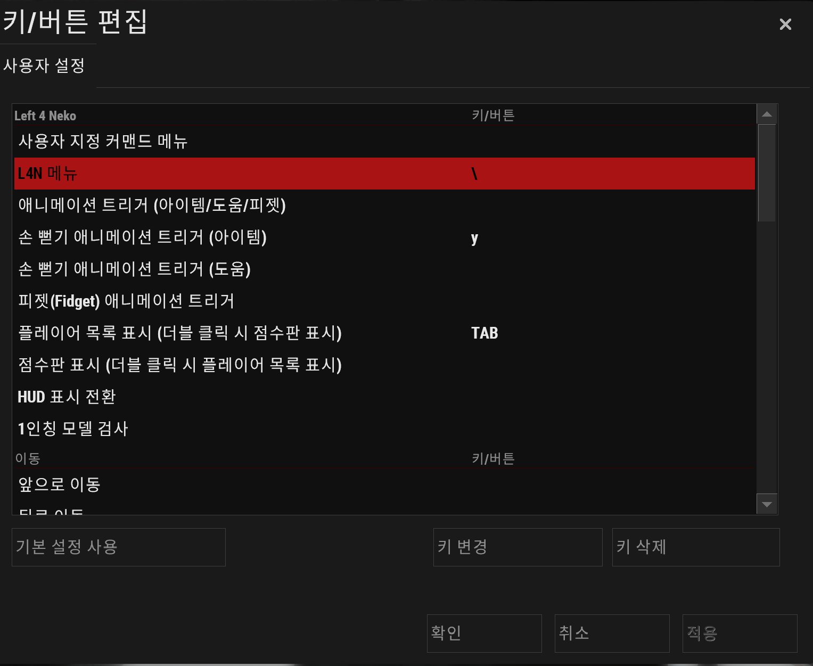
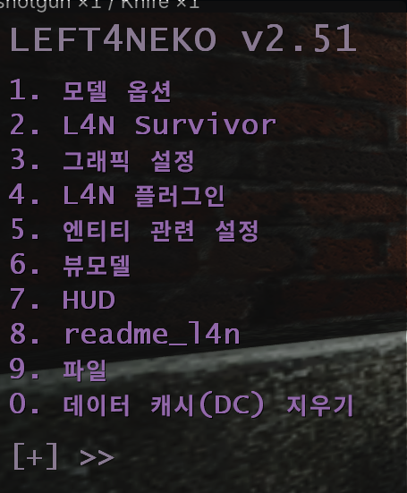
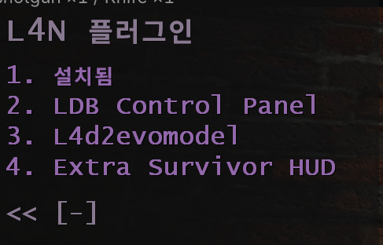
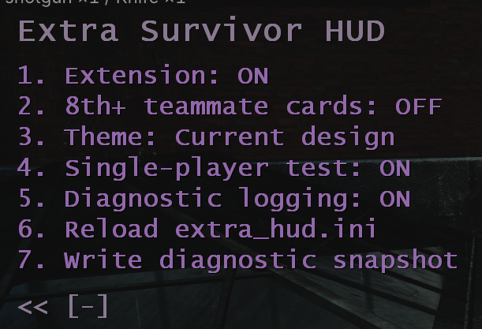
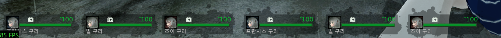
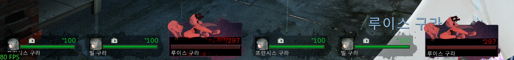
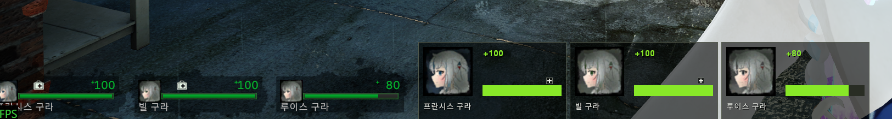
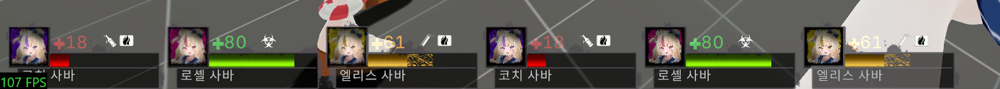
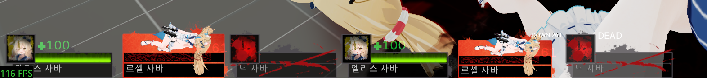

[한국어 안내 바로가기](README.ko.md)

# L4D2 Outbreak Experience HUD (Built with Neko)

**[Download now — 0.1.23 Final ZIP](https://github.com/Hu-Myo/L4D2-Outbreak-Experience-HUD-Neko/releases/download/v0.1.23/L4D2-Outbreak-Experience-HUD-Neko_0.1.23-final.zip)**

Extra teammate HUD cards for Left 4 Dead 2 with Neko. **0.1.23 is the final planned release.** This release wraps up development. Thank you for playing and testing.

[Patch notes](CHANGELOG.md) · [한국어 변경 사항](CHANGELOG.ko.md)

In 0.1.23, the teammate you spectate after dying stays eligible for an extra HUD card. It also includes earlier improvements to downed and hanging styles in the **In-game HUD** theme, item icons, and card placement.

Requires a supported Neko installation for the Windows version of Left 4 Dead 2. The DLL uses the name **NekoExtraHUD**; the menu is **Extra Survivor HUD**, or **추가 생존자 HUD** in the Korean menu.

> **Account and server restriction notice:** This DLL modifies the game at runtime. The author cannot guarantee that using it will not result in game/server restrictions or account bans. To the extent permitted by law, the author accepts no responsibility for such penalties. Use it only if you accept these risks of restrictions or bans.

## Installation

### 1. Set up Neko

Following the [NekoShaders & L4N author's Workshop instructions](https://steamcommunity.com/sharedfiles/filedetails/?id=3558049615):

1. Subscribe, start L4D2, let the Workshop download finish at the main menu, then close the game completely.
2. In the game folder, open `left4dead2/addons/workshop` and change `3558049615.vpk` to `3558049615.zip`. Enable file extensions in Explorer if they are hidden.
3. Unpack it beside `left4dead2.exe`, replacing files as directed by the author. See the included `readme_l4n.txt` for details and updates.

This HUD targets **Neko 2.51.0**. Other Neko or game versions may not show the extra HUD.

### 2. Add this HUD

1. Open [Releases](https://github.com/Hu-Myo/L4D2-Outbreak-Experience-HUD-Neko/releases) and download the **0.1.23 Final ZIP** from the release assets. The release also lists GitHub's source archives for developers.
2. With the game fully closed, place `NekoExtraHUD.dll` at:

   ```text
   <Left 4 Dead 2>/bin/neko/plugins/NekoExtraHUD.dll
   ```

3. If the package includes an example `extra_hud.ini`, new users can put it at `<Left 4 Dead 2>/left4dead2/neko/extra_hud.ini`. Keep your existing file when updating so your settings are preserved.
4. Start the game and load a map. Enter `l4n_menu` in the console, then select **L4N Plugins → Extra Survivor HUD** and set **Extension: ON**. To preview extra cards in a normal four-survivor game outside full teammate replacement, enable **Single-player test**.

<details>
<summary>Show the menu access guide with screenshots</summary>

These screenshots show an earlier version. The new eighth option and the translated 0.1.18 labels are not shown here.

**1. Optional: choose a key for the Neko menu**

The `\` key shown in this example is the user's chosen binding, **not a default key**. You can use your own binding or enter `l4n_menu` directly in the console after a map has loaded.



**2. Open the Neko menu**

Use your assigned key or `l4n_menu` to open the main menu.



**3. Select L4N Plugins**

Open **L4N Plugins** (shown as **L4N 플러그인** in the Korean menu), then choose **Extra Survivor HUD**.



**4. Adjust Extra Survivor HUD**

Turn **Extension: ON** to enable it, choose a theme, and use **Single-player test** if you want a preview with three existing teammates.



</details>

## What you see in a game

When you join a game with more teammates than your usual HUD can show, additional teammate cards appear from the **lower-left corner**. They continue across the available space and form more rows upward when needed. Their positions adjust to the card size and the space occupied by your existing HUD.

If your custom HUD shows three teammates, the extra cards cover the teammates it leaves out. If it shows four, those four do not need an additional copy. Your own player HUD remains visible.

Each extra card shows the teammate's name, portrait, health, and status. The health number includes temporary health. Downed and hanging teammates show their remaining health; dead teammates have a death display. The exact artwork and arrangement depend on the selected theme and your HUD.

With **nine or more survivors**, or **repeated survivor characters**, the plugin can show the complete teammate HUD in place of the usual teammate cards. Matching player nicknames alone do not activate this behavior.

In **0.1.18**, **Replace L4D1 team HUD** is ON by default. When the game is using L4D1 survivors, it shows every teammate through the extra HUD in place of the usual teammate cards, including in a four-survivor game. Your own HUD remains visible. Turning this option OFF releases this L4D1-specific replacement; the separate nine-survivor and repeated-character rules still apply.

In a standard four-survivor game that keeps its usual teammate HUD, seeing **no extra cards is normal**. Use **Single-player test** to preview the extra HUD with your three existing teammates. When the complete teammate HUD is already being replaced, those teammates are already visible and this preview is unnecessary.

## Options in the game

After a map has loaded, open the console, enter `l4n_menu`, and select **L4N Plugins → Extra Survivor HUD** (**추가 생존자 HUD** in Korean). Menu toggles are saved automatically.

The menu uses Korean when the game's language is Korean, and English otherwise.

| English / Korean menu label | Default | What it does |
| --- | --- | --- |
| **Extension / 추가 HUD** | ON / 켜짐 | Shows or hides NekoExtraHUD. The usual teammate HUD follows your Neko settings. |
| **8th+ teammate cards / 8번째 이후 팀원 HUD** | OFF / 꺼짐 | ON allows teammate cards beyond the first seven teammates, excluding you, when there is room. OFF normally limits the combined teammate HUD to seven teammates. This limit does not apply while the complete teammate HUD is being replaced. |
| **Theme / 테마** | Current design / 현재 디자인 | **Current design / 현재 디자인** uses the plugin's simple card appearance. **In-game HUD / 게임 내 HUD** follows the HUD appearance currently used in your game, including available portraits, health bars, item icons, and downed/death artwork. Some custom HUD elements may look different. |
| **Single-player test / 싱글 테스트** | OFF / 꺼짐 | In a standard four-survivor game with three visible teammate cards, shows an extra copy of those three teammates for testing. It does not add players or bots. Full replacement already shows the actual teammates. Turn this preview OFF for normal play. |
| **Diagnostic logging / 진단 로그** | ON / 켜짐 | Enables or disables detailed diagnostic logging. OFF does not remove basic startup or error messages. It does not change the HUD's appearance. |
| **Reload extra_hud.ini / extra_hud.ini 다시 불러오기** | Action | Applies settings you have saved in `extra_hud.ini`. |
| **Write diagnostic snapshot / 진단 정보 기록** | Action | Writes a diagnostic report to `extra_hud.log`. It does not take a screenshot or change the display. |
| **Replace L4D1 team HUD / L4D1 팀원 HUD 전체 대체** | ON / 켜짐 | **New in 0.1.18.** Replaces all teammate cards when the game is using L4D1 survivors, while keeping your own HUD. This also works in a four-survivor game. OFF disables this rule; nine-survivor or repeated-character replacement can still apply. |

### Portraits and item icons

With **In-game HUD**, available item icons include healing items, pills or adrenaline, and throwables. Their appearance depends on your active HUD and the teammate's inventory. A simpler item symbol or state appearance can still be used when the matching artwork is unavailable.

If a teammate is using a Neko model with suitable portrait artwork, the extra card can use that artwork automatically. This follows your existing Neko model selections; there is no separate portrait switch. If suitable artwork is unavailable, the survivor portrait is used.

### Display examples

These reference screenshots use custom HUDs and Neko models. Their artwork comes from the installed add-ons and can differ from your setup. They show earlier versions. The L4D2 images are reference examples and are not separate confirmation of every state in 0.1.16.

**Custom HUD used in the L4D1 examples**

The L4D1 **In-game HUD** screenshots for 0.1.16 use [L4D1 Hud Only In L4D1 Official Campaigns](https://steamcommunity.com/sharedfiles/filedetails/?id=3734687754), a separately installed custom HUD, with its teammate panels locally resized to 60%. That add-on credits [L4D1 HUD+ by tomaz](https://steamcommunity.com/sharedfiles/filedetails/?id=2987439394), which builds on Urik's original L4D1 HUD.

The extra cards reflect that installed HUD when **In-game HUD** is selected. Character portraits and downed artwork also depend on the installed model and portrait add-ons. These HUD and model assets are separate from this plugin's download.

**L4D1 — normal display with In-game HUD**

Normal survivor portraits and teammate health in the selected HUD appearance.



**L4D1 — downed display with In-game HUD**

Downed survivor artwork and remaining health.



**L4D1 — Current design**

The plugin's simple card appearance for teammates in their normal state.



**L4D2 — item icons with In-game HUD**

A reference example of healing items, pills or adrenaline, and throwables.



**L4D2 — downed and dead displays**

A reference example of downed health and death displays.



## Size and position settings

These settings are in `left4dead2/neko/extra_hud.ini`, under `[hud]`. Save your changes, then select **Reload extra_hud.ini** in the menu.

| Setting | Default | What it changes |
| --- | --- | --- |
| `scale_percent` | `85` | Extra card size as a percentage of the detected teammate card size. Effective range: 50–120%. |
| `gap` | `6` | Horizontal spacing between extra cards, up to 40 pixels. In-game HUD may follow your current HUD's spacing instead. |
| `row_gap` | `8` | Space between rows, up to 60 pixels. |
| `offset_x` | `0` | Moves the starting position to the right. Negative values do not move it left of the starting edge. |
| `offset_y` | `0` | Negative values move the starting position upward. Placement stays within the screen. |

The extra HUD starts at the lower left even if your custom teammate HUD is located elsewhere. The number of cards that fit depends on your resolution, HUD size, and available space.

## Report a bug

If you encounter a bug while playing, please open an issue with the steps to reproduce it, your HUD theme, and the number of survivors. A screenshot can help with display issues. [GitHub Issues](https://github.com/Hu-Myo/L4D2-Outbreak-Experience-HUD-Neko/issues)

Redistribution terms: [Korean license](LICENSE) · [English translation](LICENSE.en.txt).

